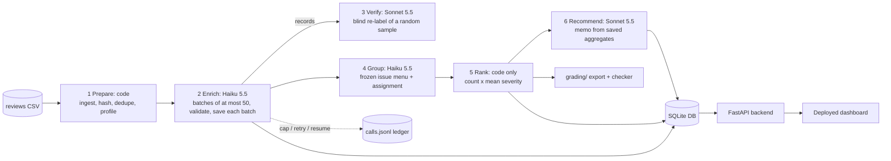

# Spotify review insight pipeline

Where should the next quarter of Spotify product effort go? This repo is a multi-role AI pipeline over the 660,622-review course extract, plus a deployed dashboard.
**Read "Scope and honest limits" first:** the final run classified **99,970 of 660,609** nonempty reviews (**15.1%**, a seeded random sample). The other reviews are accounted for and quarantined as `not_attempted_budget_limit`; they were never labeled and are not counted in any result.

- **Live dashboard:** `TODO: paste the Render URL here after deploying (see "Deploy the dashboard")`
- **Access instructions:** public, no login. Click an issue row to see its source reviews; click a `C0x-...` chip in the recommendation to open the cited issue; paste a review ID into "Trace a review".
- Setup, commands and file map are below. Offline replay and ranking need **no API key**.

## Results summary

| Item | Value | Evidence |
|---|---|---|
| Source rows accounted for (one record each) | 660,622 | `grading/records.jsonl.gz`, `grading/ingestion.json` |
| Empty texts quarantined (`empty_review_text`) | 13 | `results/quarantine.jsonl.gz` |
| Classified (completed) | 99,970 (15.13% of 660,609 nonempty) | `results/run_summary.json` |
| Of those, exact-duplicate text reuse (`cache_source_id`) | 21,913 (no model call; every ID kept as its own record) | `grading/records.jsonl.gz` |
| Failed validation (kept with reason) | 30 (29 `evidence_not_exact_substring`, 1 `invalid_field_value`) | quarantine log |
| Not attempted (budget) | 560,609 | quarantine log |
| Official checker (`tools/check_submission.py`) | status `review_required`; **only** issue is `unfinished_classification` (560,639); coverage candidate 0.4908 | `python tools/check_submission.py check ...` (below) |
| Model calls (final run dir) | 2,854 logged, 5 failed, **$5.11** logged API cost | `grading/calls.jsonl`, `results/run_summary.json` |
| Golden-50 agreement, first run (before any rule revision) | topic 78%, intent 90%, severity exact 88% (within 1: 100%) | `evals/golden_report_v1_untuned.md` |
| Blind verifier (Sonnet 5.5), 200 reviews | topic 86%, intent 89%, severity exact 87.5%, all three 71.5% | `results/verify_report.json` |
| 100-review pilot (cold / warm) | 82.3 s and $0.0654 / 0.05 s, 0 calls, $0 | `cost/report.md`, `cost/pilot_runs.jsonl` |
| Tests | 8 offline tests pass; 6/6 real-model injection cases pass | `tests/`, `evals/run_injection_test.py` |

Measured results are in the tables above; anything labeled *estimate* (calculator projections, full-corpus cost) is not a measurement.

## Scope and honest limits

- **Partial classification.** Budget was about $10 of API credit. A full 660,609-review run was estimated at roughly $25+ for enrichment alone, so I classified a **seeded random 100,000-review sample** (`tools/make_sample.py`; includes the 10,000 development reviews and the golden 50). This meets the "at least 100,000" allowance, but the coverage point is proportional, and conclusions describe only the sample. Reviews are self-selected; cancellation language is intent, not observed churn; there is no revenue or plan data, and no revenue-at-risk claim is made.
- **Golden set was used to revise rules.** I ran the golden 50 first (`labels-v1`, clean result above), then read the disagreements and revised the label rules (`labels-v2`, `pipeline/labels.py`) using general wording and *new synthetic examples only*; no golden text or label is in any prompt. The `labels-v2` golden numbers (`evals/golden_report_v2_tuned.md`: topic 80%, intent 92%, severity 88%) are therefore **not held-out**. A fresh 30-review held-out set was prepared (`evals/heldout_to_label.csv`); see "Held-out check" below for its status.
- **Two golden labels differ from the grading contract on purpose.** I labeled two "premium-only controls" reviews as `usability`; the contract says premium-only controls are `billing`. The pipeline follows the contract. The golden file is untouched, so those two count as disagreements.
- **Retries.** The spec allows one retry of invalid output. The run began with up to 3 attempts per batch; 56 enrich calls were a third attempt. I then reduced `MAX_ATTEMPTS` to 2.
- **Verification is a sample**, and agreement between two models is not accuracy. The verifier disagreed with the labeler on 28.5% of the 200 reviews on at least one field (topic 28, severity 25, intent 22 field-level disagreements). The largest single patterns are `usability` vs `billing` topic (9 cases, the premium-gating boundary) and severity 2 vs 3 (11 cases); severity was never off by more than 1.
- **The top-ranked issue is generic.** "General hate and uninstall requests" ranks #1 by the required formula but is vague (no specific fix); the memo says so and ranks actionable issues first. The ranking is the required baseline; the memo is the judgment layer.
- Issue menus are per topic, so a theme such as "premium gating" appears under both `billing` and `usability` issues; counts are not merged.
- Cost figures are computed from logged token usage and dated rates, not provider invoices.

## Architecture



| Stage | Owner | Input -> output | Failure behavior |
|---|---|---|---|
| Prepare | code (`pipeline/ingest.py`) | CSV -> SQLite + ingestion report; 13 empty texts quarantined | counts must match the file profile |
| Enrich | model + code validation (`pipeline/enrich.py`) | up to 50 review texts -> topic, intent, sentiment, severity, entities, exact `evidence_quote`, `needs_review` | invalid items retried once, then quarantined with reason; saved after every call; shared spend ledger reserves worst-case cost before dispatch |
| Verify | separate model (`pipeline/verify.py`) | texts only (never the first label) -> labels; code compares | disagreements listed in `results/verification.jsonl` |
| Group | model proposes a frozen menu per topic, then assigns (`pipeline/group.py`) | complaint/cancellation records -> exactly one issue each | unresolved items go to a flagged catch-all issue |
| Rank | code only (`pipeline/rank.py`, `pipeline/rerank.py`) | membership + severities -> `ranking.csv` | deterministic; reruns identical |
| Recommend | model (`pipeline/memo.py`) | top-8 ranking rows + 3 sampled quotes each -> memo with claim IDs | code extracts claim IDs into `claims.csv` and flags any number not in the allowed list |

Code owns record accounting, validation, budgets, state and arithmetic. Models only read messy language (labels, issue names, memo prose). `pipeline/run_all.py` runs every stage on any CSV.
Why each model call exists: labels need language judgment; the verifier gives an independent check; grouping needs naming and fuzzy matching; the memo turns numbers into an argument. Counting, sorting, caching and ranking are code.

## One review, traced end to end

Review `001805dd-4e6b-4278-9988-d21c52576a94` (2 stars): *"Way too many ads. Plays 1 or 2 songs and then multiple ads then does it again. Very annoying when trying to listen to music."*

1. **Source ID and hash:** original row in the CSV; `source_sha256` stored in `grading/records.jsonl.gz`.
2. **Enrichment (Haiku, labels-v2):** topic `usability`, intent `complaint`, severity 3, evidence quote *"Way too many ads. Plays 1 or 2 songs and then multiple ads"* (exact substring, checked in code).
3. **Verification:** only a random sample is verified; this review was not in it (see `results/verification.jsonl`).
4. **Issue membership:** `ISS-064` "Excessive ads on free plan" (`results/membership.csv`).
5. **Ranking:** rank 2: 5,292 complaints, mean severity 2.230537, priority 11,804 (`results/ranking.csv`).
6. **Memo claim:** `C02-count` = 5292, `C02-mean`, `C02-score` in `results/claims.csv`; the dashboard re-checks each claim against the ranking table.

**A failed case:** review `4765dcaf-18b2-4426-aa8a-4576ec59217d` ("This app was great but coul'd not download so please replace the error"). The model's quote was not an exact substring (it fixed the typo "coul'd"). The batch was retried once; the quote was still invalid, so the record was **not** saved as a success. It is in `results/quarantine.jsonl.gz` with reason `evidence_not_exact_substring` and counts as unfinished. A review where tone and topic conflict, or where the language is unsupported, is routed by the `needs_review` flag and the "unclear" rules in `pipeline/labels.py`.

## Rubric map

**Deliverable quality (4)**
- Accessible code/setup/artifacts: this README, `requirements.txt`, `.env.example`, `.gitignore`; `pipeline/`, `cost/`, `evals/`, `tests/`, `grading/`, `results/`.
- Architecture, shared schema, provenance: diagram above; schema in `pipeline/enrich.py` (`TOOL`), labels in `pipeline/labels.py`; `label_config` + `source_sha256` + `cache_source_id` on each record.
- Memo numbers linked to calculations and evidence: `results/memo.md`, `results/claims.csv` (checker confirms each value), dashboard chips.
- Recommendation, alternatives, limitations: `results/memo.md` and "Scope and honest limits".

**Testing and evaluation (3)**
- 50 human labels, per-field comparison, error analysis: `evals/golden_50_labeled.csv`, `evals/golden_report_v1_untuned.md`, `evals/golden_report_v2_tuned.md` (confusion tables, MAE, needs_review, quote checks, concrete disagreements).
- Independent verification, planted-error, injection tests: `pipeline/verify.py`, `results/verify_report.json`, `tests/test_pipeline.py` (planted bad values, fake quotes, unknown/duplicate IDs, missing items, spend cap, resume), `tests/test_verify_planted.py` (a deliberately wrong label in a test copy is flagged), `evals/run_injection_test.py` (6/6).
- Cost/runtime calculator + controls: `cost/` (below); controls demonstrated in `tests/` (cap blocks calls, bounded retries, resume) and `evals/resume_demo_log.txt`.

**Working result (3)**
- Full ingestion, coverage, classification: `grading/`, `results/run_summary.json` (coverage is partial: see limits).
- Runnable staged program, bounded calls, saved handoffs, resume: `python -m pipeline.run_all`, 50-review max requests (`calls.jsonl`), interruption evidence: the 100k run's process ended unexpectedly partway (exit code 1, cause not diagnosed) and was restarted with `--phase resume` (`grading/checkpoint_before.json` 43,380 IDs -> `checkpoint_after.json` 99,970 IDs, no completed ID re-sent), plus `tools/resume_demo.py` / `evals/resume_demo_log.txt`. **Recording:** `TODO: link the screen recording`.
- Reproducible ranking + deployed dashboard: `python -m pipeline.rerank` (below); dashboard in `dashboard/`.

## Commands

```bash
pip install -r requirements.txt            # only fastapi + uvicorn; the pipeline itself uses the standard library
cp .env.example .env                       # then add ANTHROPIC_API_KEY (never commit .env)
# Place the course CSV at data/spotify_reviews_18months.csv (sha256 1fc85de6...a2cef6, 97,400,616 bytes; not committed)

python -m pipeline.run_all INPUT.csv --run-dir work/myrun --cap 2.00 --workers 4   # all stages, paid, resumable
python -m pipeline.rerank --records grading/records.jsonl.gz --membership grading/membership.csv --out ranking_rerun.csv --compare grading/ranking.csv   # no model calls
python cost/calculator.py                  # offline replay of the cost/runtime calculator, no key
python cost/calculator.py --rate-multiplier 2   # doubles API spend, time unchanged
python -m unittest tests.test_pipeline tests.test_verify_planted    # offline, free
python tools/check_submission.py profile --full data/spotify_reviews_18months.csv --out grading/ingestion.json
python tools/check_submission.py reference --full data/spotify_reviews_18months.csv --analysis data/spotify_reviews_18months.csv --out local-reference.json
python tools/check_submission.py check --reference local-reference.json --submission grading --out self-check.json
```

Explicit paid commands: `python cost/run_pilot.py --label cold|warm --run-dir work/pilot_final`, `python -m pipeline.enrich ...`, `python evals/run_injection_test.py`.

## Cost and runtime calculator (`cost/`)

`cost/report.md` (offline replay output), `cost/rates.csv` and `rates.json` (dated Anthropic prices, source link), `cost/usage.csv`, `cost/pilot_records.jsonl`, `cost/pilot_calls.jsonl`, `cost/pilot_runs.jsonl` (cold and warm runs with stage timings), `cost/calculator.py`, `cost/run_pilot.py`, `cost/report_crosscheck.md` (pilot estimate vs the real 100k run).
Settings used: Haiku 5.5 for enrich and group, Sonnet 5.5 for verify and memo; tier standard (no Batch API); no thinking; batch size 25 in the pilot, 50 in the large runs; one worker in the pilot, 6 in the 100k run. A fallback to a stronger model for hard cases was not used (declared fallback fraction 0).
The pilot ran the full chain on `cost_100.csv` with an empty cache (cold, 4 enrich + 1 verify + 10 group + 2 memo calls, 82.3 s, $0.0654), then warm (0 calls, 0.05 s, $0). Local compute and electricity cost: **unknown, not counted as zero**.

## Held-out check

Because the golden results informed the rules, the assignment asks for fresh held-out cases. `evals/heldout_to_label.csv` has 30 reviews from the 10,000 development set that are not in the golden 50 or the 500 checkpoint; `evals/label_heldout.html` is the labeling page. `TODO: held-out labels not yet entered; once labeled, run python evals/score_golden.py <records> --held-out evals/heldout_labeled.csv`. Until then the only untuned evidence is the first golden run.

## Deploy the dashboard

The dashboard is a FastAPI backend (`dashboard/app.py`) that reads a SQLite database (`dashboard/data/spotify.sqlite.gz`, built by `dashboard/build_db.py` from the saved outputs, 99,970 classified reviews, issues, ranking, claims, memo) and serves JSON plus a static page. No API key and no model calls are needed to view it.
1. Push this repo to GitHub (public). 2. On [render.com](https://render.com) choose **New -> Blueprint**, select the repo; it reads `render.yaml` (free web service, `pip install -r requirements.txt`, `uvicorn dashboard.app:app`). 3. Open the URL and put it at the top of this README. Free instances sleep; the first load can take about a minute.
Local: `uvicorn dashboard.app:app --port 8000`. Rebuild the database: `python dashboard/build_db.py --run-dir work/c10000 --input data/sample_100k.csv`.

## File map

`pipeline/` stage code | `tools/` sample, labeling pages, checker, packaging | `cost/` calculator | `evals/` golden set, reports, injection and resume evidence | `tests/` offline tests | `grading/` standardized export | `results/` issues, ranking, memo, claims, quarantine log, run summary, verifier output | `dashboard/` backend, page, database | `NOTES.md` working notes.
Data: supplied by the course (CC0, Kaggle "3.4 Million Spotify Google Store Reviews" v2); checksum in `results/data_manifest.json`.

## AI assistance

Claude (Anthropic) helped write the code under direction, and Claude models run the pipeline roles. Golden-set labels and all scope/budget decisions are mine. Nothing here was simulated: usage and costs are from logged API responses, and anything unmeasured is marked as an estimate.
